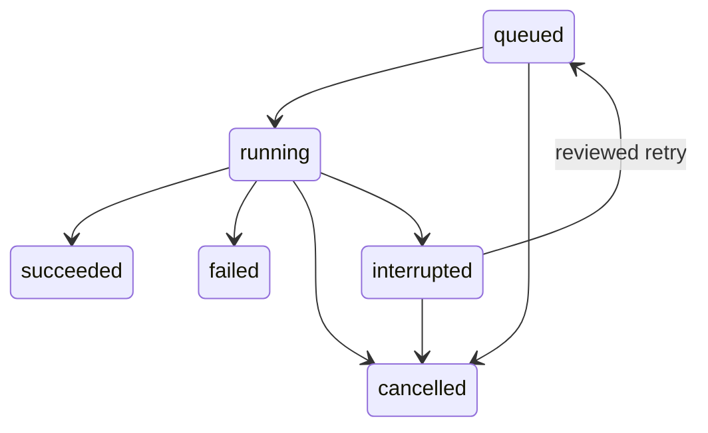

# Structure 2 — Database & State

LeeOS now has a place to remember what exists, the status of each attempt, and the history behind that status. The code is in `packages/database`. The Hub design is unchanged; its structure label and database wording were corrected.

## The five ideas to learn first

1. **ID = permanent identity.** A project receives `proj_` followed by a UUID. Its name can change; its ID cannot. UUIDs avoid one central number counter when workers are added later. Database constraints validate prefixes, and triggers prevent ID changes.
2. **Automation = recipe; run = one attempt.** A run saves the automation definition and version it started with. Editing the recipe does not rewrite old runs.
3. **Job = one step within a run.** A job keeps its status, attempt number, and latest checkpoint. A checkpoint records where work stopped; it should contain small JSON values and artifact references.
4. **Event = something that happened.** Renaming a project and recording its rename event happen in one transaction. Either both commit or neither does. Event rows are append-only through ordinary SQL updates/deletes; this is not a tamper-proof audit service against database administrators.
5. **Migration = numbered change to the filing system.** `001_state.sql` builds this first schema. The migration ledger saves SHA-256 checksums (normalized LF text). Re-running unchanged migrations does nothing; editing an applied migration is rejected. Add a new file for the next change.

## What goes on each shelf

| Table | Purpose |
| --- | --- |
| projects | Goals and their identity |
| automations | Reusable recipes, versions, and zero-only cost policy |
| runs | One attempt, its recipe snapshot, status, and version |
| jobs | Steps, attempt numbers, checkpoints, and heartbeat timestamps |
| schedules | Future timing definitions; disabled by default |
| agents | Future temporary worker assignments and permission descriptions |
| artifacts | File locations, sizes, types, and optional hashes |
| memories | Structured knowledge and provenance references |
| events | Append-only state-change history |
| notifications | Future delivery records; nothing sends messages yet |
| model_usage | Observed token counts and costs |
| model_performance | Outcomes linked to model usage |
| tool_registry | Future available tools; disabled by default |
| approvals | Future approval requests and decision records |
| system_settings | Safe defaults: zero-only spending, execution disabled, Accra timezone |

The first repository methods cover projects, automation definitions, runs, jobs, and events. The other tables establish storage contracts; their services come in later structures. Approval rows alone do not authorize actions. There are no users, authentication, model calls, schedules firing, or executors in this structure.

File contents belong in file/object storage. Git holds code and versioned definitions. PostgreSQL holds live state and references. Keep credentials in environment/secret storage; do not write passwords, tokens, signed URLs, or whole conversations into JSON checkpoints, memories, events, or artifact locations. Model cost records allow nonzero observed costs so an unexpected charge can be recorded honestly; they do not authorize spending.

## Try the state layer without Docker

```sh
npm ci
npm run db:demo
```

The demo uses PGlite, an embedded PostgreSQL engine, and saves a snapshot on clean close to ignored `.leeos/demo/database.tar`. It creates a sample project, renames it without changing its ID, records a run/job/checkpoint, and completes the records. Running it again appends another sample project/run and preserves earlier data. It never calls an AI provider or executes an external automation.

The demo snapshot is for learning and tests, not crash-safe live storage. A forced termination can lose changes since the last clean close. Native PostgreSQL is the durable live-state path.

The demo is one process at a time. `.leeos/demo.lock` prevents two demo commands opening the same data. If the process dies, close any remaining demo process before removing a stale lock. This local demonstration is separate from the Hub’s database; it is not a shared worker server.

## Connect the Hub to local PostgreSQL

Prerequisite: Docker with Compose, or your own PostgreSQL 17+ server. No hosted account is needed. Docker is not installed automatically.

```sh
npm run db:configure
docker compose up -d db
npm run db:migrate
npm run db:status
npm run dev
```

`db:configure` creates a random local password and matching ignored `.env` and `apps/hub/.env.local`. It refuses to overwrite existing files. Do not use example placeholder passwords. The Compose database listens only on `127.0.0.1:5432` and keeps its data in a named volume. If you use an existing PostgreSQL server, create a dedicated empty LeeOS database and set its URL in both ignored environment files instead.

Root commands load root `.env`; Next.js loads `apps/hub/.env.local`. Restart the Hub after changing its environment. Do not put database URLs into `NEXT_PUBLIC_*` variables. Provisioning a hosted database is outside this structure and must be checked for costs first.

- `/api/health` is liveness: the core is responding. It does not prove database availability.
- `/api/ready` returns 200 only when the configured database responds and the expected migration ledger is present. Missing configuration, missing migrations, or connection failures return 503 with a sanitized status. Readiness does not migrate or write records.

There are deliberately no public write endpoints yet. The TypeScript repository is the entry point for state changes. Use it to preserve event history and transition rules; ad hoc SQL bypasses application-level rules. Multi-user permissions must be added before opening the system beyond local development.

## Recovery boundaries



A run cannot succeed with unfinished jobs. Failure/cancellation closes unfinished jobs. Interruption marks running jobs interrupted and retains their checkpoints. Requeue returns interrupted jobs to pending, and starting them increments the attempt number. Completed jobs stay completed.

Every run update checks its expected version. Every checkpoint/completion checks both checkpoint version and worker-attempt number. A worker from an earlier attempt cannot overwrite a resumed worker’s checkpoint, even if it knows the latest checkpoint version. Idempotency keys deduplicate run creation per project; reusing a key for a different automation is rejected.

This is durable bookkeeping, not automatic crash recovery. There is no worker heartbeat monitor, queue dispatcher, automatic restart, or guarantee that an outside action happened exactly once. A future execution manager must inspect interrupted work and reconcile external effects before resuming. The event sequence supports display pagination; it is not a transactional outbox or reliable delivery cursor across concurrent commits. Event delivery comes later.

## Validation and maintenance

```sh
npm run check
npm run db:demo
```

The default tests use an embedded PostgreSQL engine, exercise real SQL constraints and transactions, and close/reopen a saved database snapshot to verify persistence. A separate `npm run test:postgres` runs the same contract over the real PostgreSQL driver when `LEEOS_TEST_DATABASE_URL` is configured. It creates and drops only a uniquely named test schema; use a dedicated test database. The manual GitHub workflow also has a PostgreSQL service for this check.

Apply migrations explicitly. Do not edit a migration after it has been used; make a new numbered migration. The migration runner locks concurrent migration processes and commits all pending migration changes plus their ledger rows together. Failed migration SQL rolls the transaction back. Forward fixes are preferred to automatic down-migrations.

Read [backup and recovery](backup-and-recovery.md) before storing important work. A persistent volume is not a backup.

Sources: [node-postgres parameterized queries](https://node-postgres.com/features/queries), [PostgreSQL transaction advisory locks](https://www.postgresql.org/docs/current/functions-admin.html#FUNCTIONS-ADVISORY-LOCKS), [PGlite filesystem persistence](https://pglite.dev/docs/filesystems).

## Next boundary

Structure 3 will build the core API/service layer on these records: validated requests, project/run operations, and control contracts. Authentication and approval boundaries must be designed before exposing writes. Orchestration remains later work. Domain examples are not committed modules. Stop for Lee’s review before starting it.

Structure 3 is now built. The statements above about no public write endpoints describe the Structure 2 boundary; the current authenticated local API and its limits are documented in [Structure 3](structure-3.md).
